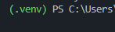

# Projeto Integrador — Ciência de Dados aplicada ao Agronegócio

Projeto acadêmico desenvolvido na **Faculdade de Tecnologia de Catanduva — FATEC**, no **Curso Superior de Tecnologia em Ciências de Dados para o Agronegócio**, na disciplina **Projeto Integrador**.

O repositório reúne as análises em Python que apoiam o desenvolvimento do projeto e do artigo acadêmico. O trabalho atual explora dados de cana-de-açúcar, com foco no ATR (Açúcar Total Recuperável), representado pela variável `atr_kg_ton`.

## Integrantes do projeto e do artigo

- Beatriz dos Santos Lio
- Bruno Bentivoglio Cezare
- Camilla Nogueira Faria Piovani
- Élio Rossi Neto
- Leonardo Almeida Santos Brito
- Yasmim Freitas de Camargo

**Professora orientadora:** Profª Dra. Fernanda Pereira Guidotti Carneiro.

## Objetivo

Explorar dados agrícolas e preparar uma base para o estudo e a previsão do ATR da cana-de-açúcar, considerando características da soqueira, variedade, textura do solo, número de corte e safra. As análises buscam apoiar a compreensão das relações entre essas variáveis e o indicador de qualidade da matéria-prima.

## Desenvolvimento atual

### Dados de demonstração para o repositório

O conjunto em [dados ficticios](dados%20ficticios/LEIA-ME.md) contém **26 CSVs inteiramente sintéticos**, organizados em análises de solo, preços de ATR e produção de cana. Os dados servem para demonstração e não representam resultados reais. Os cabeçalhos e formatos seguem as fontes de referência; o notebook atual ainda precisa ser adaptado para essas estruturas.

Os arquivos fictícios estão disponíveis diretamente no repositório. A pasta `dados brutos/` está excluída do versionamento pelo `.gitignore`.

O notebook [Interdisciplinar_CYBEL.ipynb](notebooks/Interdisciplinar_CYBEL.ipynb) contém:

- Leitura de um arquivo CSV local no VS Code.
- Inspeção da estrutura, dos tipos de dados, dos valores ausentes e dos registros duplicados.
- Estatísticas descritivas e levantamento de talhões e área cadastrada.
- Seleção das variáveis de entrada e do ATR como variável alvo.
- Preparação de conjuntos de treino e teste com separação por safra.
- Conversão de variedade e textura do solo em códigos numéricos.
- Cálculos iniciais de médias de vigor da soqueira e ATR.

O projeto está em desenvolvimento. O notebook ainda não apresenta um modelo preditivo treinado nem métricas de avaliação. O conjunto fictício disponível tem estruturas diferentes da base originalmente esperada pelo notebook; sua execução requer adaptação ou o fornecimento de uma base com as colunas descritas abaixo.

## Tecnologias

| Tecnologia | Finalidade |
| --- | --- |
| Python | Desenvolvimento das análises e processamento dos dados. |
| Pandas | Importação, organização e análise de dados tabulares; utilizado no notebook atual. |
| NumPy | Operações numéricas; incluído nas dependências. |
| Matplotlib | Construção de gráficos; incluído nas dependências. |
| OpenPyXL | Suporte a arquivos Excel; incluído nas dependências. |
| VS Code com extensões Python e Jupyter | Abertura e execução local do notebook em células. |
| Streamlit | Possível interface para apresentação das análises; incluído nas dependências, com uso ainda em definição. |

As dependências e suas versões estão registradas em [requirements.txt](requirements.txt).

## Estrutura do projeto

```text
ProjetoIntegrador_I/
├── dados brutos/                       # Dados de origem
├── dados tratados/                     # Dados após tratamento
├── img/                                # Imagens da documentação
├── notebooks/
│   └── Interdisciplinar_CYBEL.ipynb      # Análise e preparação dos dados
├── resultados/                         # Resultados finais das análises
├── LICENSE                             # Licença MIT
├── README.md                           # Documentação do projeto
└── requirements.txt                    # Dependências Python
```

## Configuração do ambiente local

Abra o PowerShell na pasta do projeto e crie o ambiente virtual:

```powershell
py -m venv .venv
```

Ative o ambiente:

```powershell
.\.venv\Scripts\Activate.ps1
```

Caso o PowerShell bloqueie a ativação, ajuste a política apenas para a sessão atual e tente novamente:

```powershell
Set-ExecutionPolicy -Scope Process -ExecutionPolicy RemoteSigned
.\.venv\Scripts\Activate.ps1
```

Com o ambiente ativo, o terminal exibirá `(.venv)`:



Instale as dependências:

```powershell
python -m pip install -r requirements.txt
python -m pip install ipykernel
```

Para encerrar o ambiente virtual:

```powershell
deactivate
```

## Execução do notebook no VS Code

1. Abra a pasta `ProjetoIntegrador_I` no VS Code, usando **Arquivo → Abrir Pasta**.
2. Instale as extensões **Python** e **Jupyter**, da Microsoft.
3. Configure o ambiente local conforme as instruções acima, usando o terminal integrado do VS Code.
4. Abra `notebooks/Interdisciplinar_CYBEL.ipynb` no editor de notebooks.
5. Clique em **Selecionar Kernel** e escolha o ambiente `.venv` do projeto.
6. Na primeira célula, ajuste `caminho_csv` para o arquivo desejado, com caminho relativo à raiz do projeto. O exemplo fornecido lê `dados ficticios/producao_cana/Cana.csv`.
7. Execute a primeira célula pelo botão ao lado dela ou com **Shift+Enter**. Execute as demais células em ordem quando a base tiver as colunas necessárias.

A leitura local usa `pandas.read_csv()`, separador `;`, ponto decimal (`.`) e codificação `utf-8-sig`, de acordo com os CSVs do repositório. Ajuste `separador` e `decimal` na primeira célula se utilizar outro formato.

O arquivo de exemplo permite carregar e inspecionar a produção de cana nas duas primeiras células. As análises seguintes ainda exigem uma base preparada com `talhao`, `area_ha`, `falhas_soqueira_pct`, `vigor_soqueira_pct`, `variedade`, `textura_solo`, `numero_corte`, `safra` e `atr_kg_ton`. Os CSVs disponíveis não fornecem todas essas colunas; será necessário adaptar as etapas seguintes ou preparar uma base compatível antes de executar o notebook inteiro.

## Licença

O código deste repositório está disponibilizado sob a [licença MIT](LICENSE).
