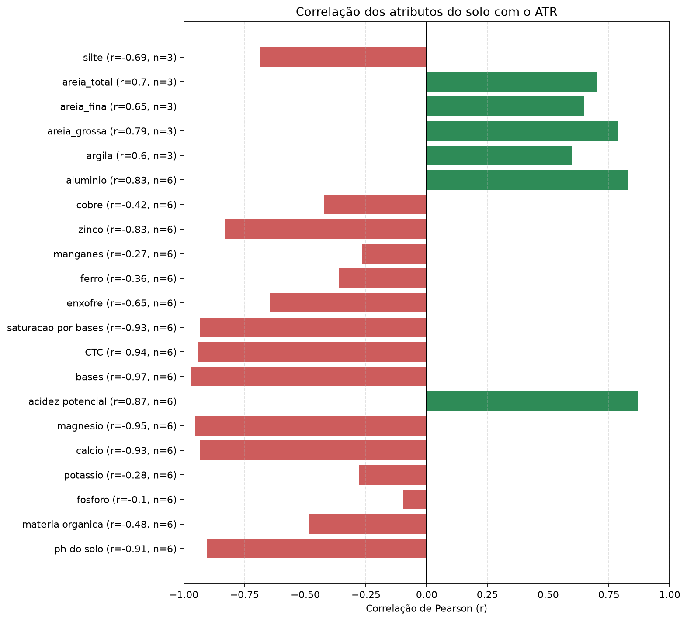
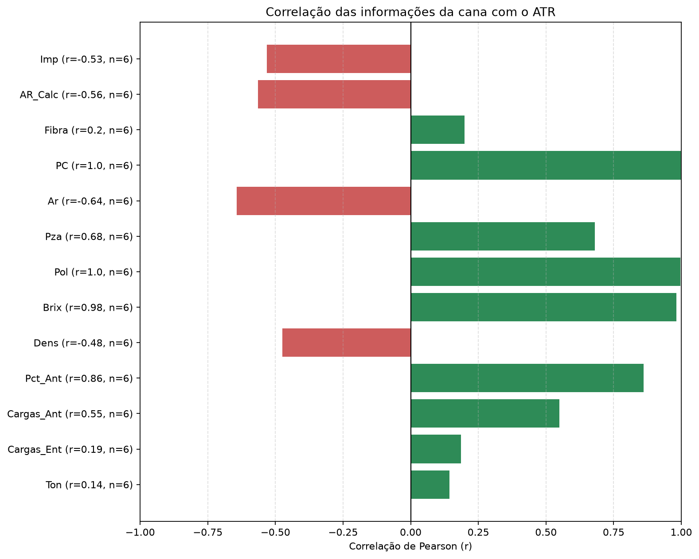
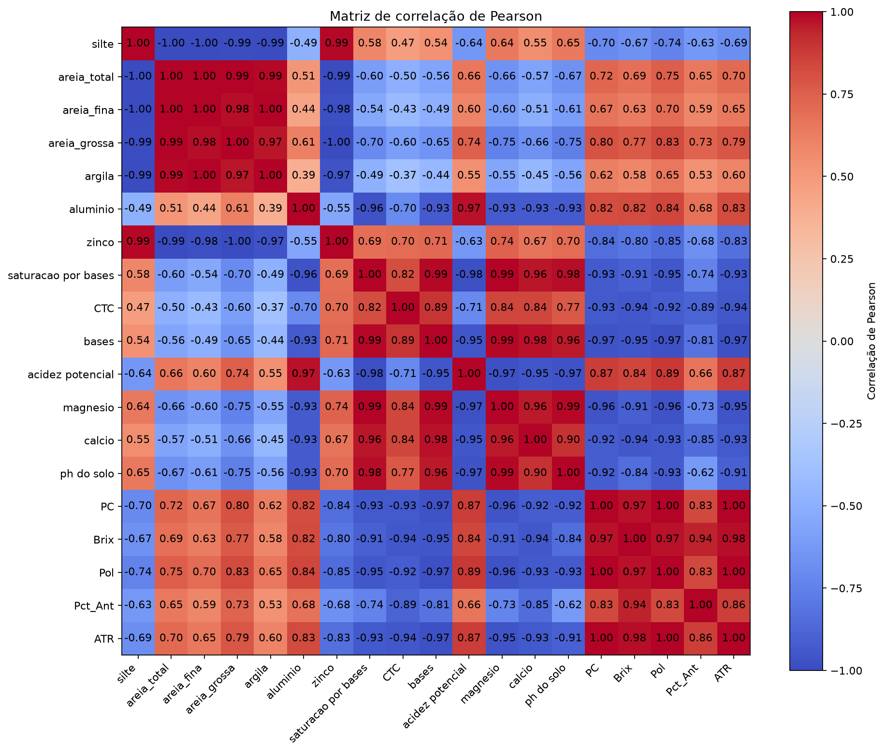

# Projeto Integrador I — Solo, soqueira e ATR da cana-de-açúcar

Repositório do artigo **“Análise da influência das características do solo e da saúde da soqueira no ATR da cana-de-açúcar”**, desenvolvido em 2026 no Curso Superior de Tecnologia em Ciência de Dados para o Agronegócio da **FATEC Catanduva**.

## Objetivo e escopo

Analisar a influência dos atributos do solo e da saúde da soqueira no **ATR (Açúcar Total Recuperável, em kg/t de cana)** e avaliar sua estimativa antes da colheita, apoiando o planejamento da produção e da receita do produtor.

O artigo propõe uma pesquisa aplicada e quantitativa, exploratória, descritiva e preditiva, em estudo de caso em **Marapoama-SP, região de Catanduva**, com dados fornecidos pela **Associação dos Fornecedores de Cana da Região de Catanduva (AFCRC)**. A unidade analítica prevista é **uma linha por talhão e safra**.

## Metodologia prevista

O estudo adota o CRISP-DM para organizar entendimento do negócio e dos dados, preparação, modelagem, avaliação e implantação, conforme o avanço do projeto.

- **Dados:** laudos de solo, registros de soqueira e manejo e boletins de ATR; precipitação como variável complementar, se disponível.
- **Preparação:** limpeza, padronização de unidades e identificação dos talhões, análise de ausências e inconsistências e integração por talhão e safra.
- **Análise e modelo:** estatística descritiva, correlações de Pearson/Spearman e regressão linear simples para estimar o ATR a partir de uma única variável explicativa, ainda a definir. Os demais atributos podem ser explorados sem integrar simultaneamente esse modelo.
- **Avaliação:** treino/teste na proporção 80/20 proposta no artigo e métricas R², MAE e RMSE. Essa preparação ainda precisa ser implementada e conciliada com a separação temporal do notebook.

## Estado atual e dados

O [notebook](notebooks/CYBEL.ipynb) contém leitura de CSVs, preparação de tabelas anuais de solo e cana, correlações de Pearson e gráficos exploratórios. **Ainda não há regressão linear simples treinada nem métricas de avaliação.** A integração atual é por ano civil e difere da unidade por talhão e safra prevista no artigo.

As fontes disponíveis ainda não formam a base por talhão e safra exigida: faltam registros de soqueira/manejo e ATR correspondente por talhão. O ATR agregado não deve ser repetido em cada amostra de solo para criar exemplos de treinamento.

Os dados originais ficam locais, fora do versionamento. A base fictícia também não é distribuída no repositório. Antes da integração, será necessário harmonizar nomes e unidades: o artigo denomina o alvo `atr`, enquanto o notebook atual usa `ATR`.

```text
dados brutos/     # Fontes originais locais, excluídas do Git
dados tratados/   # Destino das bases após limpeza e integração
notebooks/       # Código e análises
img/             # Imagens da documentação
```

## Resultados exploratórios

Os gráficos abaixo foram gerados pelo notebook com as bases locais. O pareamento anual abrange **2020 a 2025**, com seis observações; as variáveis de textura têm somente três anos válidos. As correlações não demonstram causalidade nem desempenho de um modelo preditivo.

**Atributos do solo e ATR.** As barras apresentam a correlação de Pearson e o número de anos válidos (`n`) para cada atributo.



**Indicadores da cana e ATR.** PC, Pol e Brix apresentam associações positivas elevadas nesta amostra. São indicadores ligados à qualidade e ao cálculo do ATR; essas associações não comprovam previsão antes da colheita.



**Matriz de correlação.** Resume as associações entre as variáveis selecionadas, permitindo observar também relações entre possíveis entradas do modelo. Cada par utiliza os anos com valores disponíveis.



Os resumos são unidos apenas pelo ano, sem validar correspondência entre propriedades. Portanto, estes resultados são preliminares e precisam dessa conferência antes de interpretações agronômicas.

## Execução no VS Code

Instale as extensões **Python** e **Jupyter**, abra a pasta do projeto e execute no terminal PowerShell:

```powershell
py -m venv .venv
.\.venv\Scripts\Activate.ps1
python -m pip install -r requirements.txt
python -m pip install ipykernel
```

Abra `notebooks/CYBEL.ipynb` e selecione o kernel `.venv`. A primeira célula lê os CSVs da pasta `dados tratados`. O notebook espera arquivos identificados como `DADOS_SOLO`, `Cana.csv` e, opcionalmente, `ART.csv`, com as colunas utilizadas nas células seguintes.

Execute as células em ordem com **Shift+Enter**. Os CSVs utilizados estão disponíveis na pasta `dados tratados` do repositório; os arquivos de `dados brutos` permanecem locais.

**Ferramentas:** Python, Pandas, NumPy e Matplotlib; Seaborn e scikit-learn previstos nas próximas etapas. GitHub para versionamento, Trello para tarefas e Overleaf para redação do artigo.

## Equipe

Beatriz dos Santos Lio; Bruno Bentivoglio Cezare; Camilla Nogueira Faria Piovani; Élio Rossi Neto; Leonardo Almeida Santos Brito; Yasmim Freitas de Camargo.

**Orientadora:** Profª Dra. Fernanda Pereira Guidotti Carneiro.

Código sob [licença MIT](LICENSE).
