# Projeto Integrador I — Solo, características da cana e ATR da cana-de-açúcar

Repositório do artigo “Análise da influência das características do solo no ATR da cana-de-açúcar”, desenvolvido em 2026 no Curso Superior de Tecnologia em Ciência de Dados para o Agronegócio da FATEC Catanduva.

## Objetivo e escopo

Analisar a influência dos atributos do solo e das características do solo no ATR (Açúcar Total Recuperável, em kg/t de cana) e avaliar sua estimativa antes da colheita, apoiando o planejamento da produção e da receita do produtor.

O artigo propõe uma pesquisa aplicada e quantitativa, exploratória, descritiva e preditiva, em estudo de caso em Marapoama-SP, região de Catanduva, com dados fornecidos pela Associação dos Fornecedores de Cana da Região de Catanduva (AFCRC). A unidade analítica prevista é uma linha por talhão e safra.

## Metodologia prevista

O estudo adota o CRISP-DM para organizar entendimento do negócio e dos dados, preparação, modelagem, avaliação e implantação, conforme o avanço do projeto.

- **Dados:** laudos de solo, características do solo e manejo e boletins de ATR; precipitação como variável complementar, se disponível.
- **Preparação:** limpeza, padronização de unidades e identificação dos talhões, análise de ausências e inconsistências e integração por talhão e safra.
- **Análise e modelo:** estatística descritiva, correlações de Pearson/Spearman e regressão linear simples para estimar o ATR a partir de uma única variável explicativa, ainda a definir. Os demais atributos podem ser explorados sem integrar simultaneamente esse modelo.
- **Avaliação:** treino/teste na proporção 80/20 proposta no artigo e métricas R², MAE e RMSE. A divisão em treino/teste e as métricas MAE e RMSE ainda precisam ser implementadas, com uma estratégia de separação que considere a ordem temporal dos dados. O R² atual é calculado na própria amostra de ajuste.

## Notebook e dados

O [notebook CYBEL](notebooks/CYBEL.ipynb) explora associações entre atributos do solo, indicadores da cana entregue à usina e ATR. A unidade da análise principal é o **ano civil**. A tabela `dados_anual` reúne seis anos em comum, de 2020 a 2025. O relatório de cana também inclui 2026, mas a base de solo não tem registros pareados para esse ano.

| Arquivo em `dados tratados` | Conteúdo                                                                                                                            |
| ----------------------------- | ------------------------------------------------------------------------------------------------------------------------------------ |
| `DADOS_SOLO_tratados.csv`   | Laudos de solo com data da amostragem, propriedade, talhão, variedade e atributos químicos e de textura.                           |
| `Cana.csv`                  | Relatório de cana com período, fazenda, tonelagem, cargas e indicadores de qualidade, incluindo ATR.                               |
| `ART.csv` (opcional)        | Preços relacionados ao ATR por período. Esses valores ficam disponíveis para consulta e não entram nos cálculos desta análise. |

Os arquivos de `dados brutos` ficam fora do versionamento. As figuras do README ficam em `img`.

## Guia do notebook

Os blocos de texto do notebook explicam cada uma das 15 etapas de execução. A tabela resume a sequência e as principais saídas.

| Etapas                                     | O que o notebook faz                                                                                                                                                                                                                                                                                                                                                                             |
| ------------------------------------------ | ------------------------------------------------------------------------------------------------------------------------------------------------------------------------------------------------------------------------------------------------------------------------------------------------------------------------------------------------------------------------------------------------ |
| 1–2. Leitura e integração               | Lê os CSVs, confere cabeçalhos e ausências e filtra as linhas de fazenda para excluir os totais do relatório. Calcula médias de solo por propriedade, talhão e ano e dá o mesmo peso a cada grupo com valor disponível. Soma toneladas e cargas e pondera os indicadores da cana pela tonelagem. Combina as tabelas pelo ano da amostragem do solo e pelo ano de `Data_Final` da cana. |
| 3–5. Variedades e médias                 | Resume atributos do solo em `media_anual_por_variedade` e conta os talhões amostrados por variedade em cada ano. Compara essa participação com o ATR anual agregado da fazenda. Calcula também as médias dos valores disponíveis em `dados_anual`.                                                                                                                                     |
| 6–9. Correlações                        | Calcula Pearson para os pares anuais disponíveis, imprime o coeficiente e a contagem de pares e gera gráficos de barras e um mapa de calor. O cálculo exige pelo menos três pares e variação nas duas séries.                                                                                                                                                                             |
| 10–13. Dispersões e regressões          | Mostra pontos identificados pelo ano e tenta ajustar uma regressão linear simples para cada atributo selecionado. Cada ajuste usa um atributo por vez e exige pelo menos três pares. A equação e o R² são calculados na amostra de ajuste.                                                                                                                                                 |
| 14–15. Conferência e análise por grupos | Lista os anos com alumínio disponível e procura um CSV detalhado para calcular ATR ponderado por variedade, corte e safra. A etapa exige `Talhao`, `Variedade`, `Corte`, `Ton`, `ATR` e uma referência de safra (`Safra`, `Ano` ou `Data_Final`).                                                                                                                             |

## Resultados e discussão

As figuras abaixo foram extraídas das saídas salvas no notebook. A média aritmética dos seis valores anuais de ATR foi **134,32 kg/t de cana**. O ATR passou de 138,4 kg/t em 2020 para 143,7 kg/t em 2022 e caiu nos anos seguintes, chegando a 122,7 kg/t em 2025.

### Variedades dos talhões amostrados

As barras mostram a participação de cada variedade na contagem de talhões amostrados com variedade identificada. A linha usa o eixo da direita e representa o ATR anual da fazenda, ponderado pelas toneladas. A participação pode variar com o esforço de amostragem. Para medir a participação na área plantada, seriam necessários dados de área por variedade.

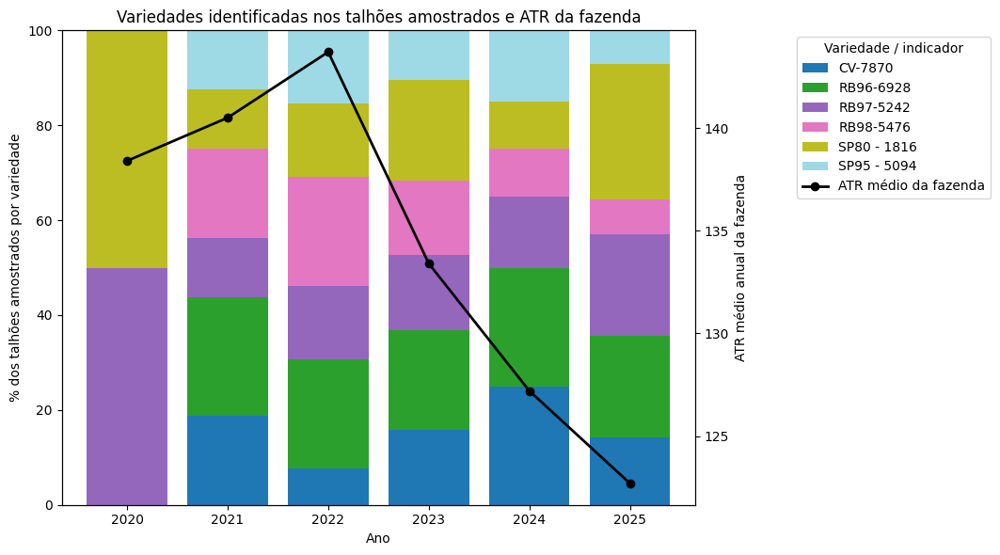

### Correlações de Pearson

Entre os atributos selecionados para regressão, pH (r = −0,906) e acidez potencial (r = 0,868) apresentaram as associações mais fortes com o ATR. Fósforo (r = −0,098) e potássio (r = −0,278) tiveram associações fracas. Para alumínio, r = 0,771 com quatro anos válidos. O resultado é sensível a poucos pontos e ao tratamento de 378 zeros como ausentes. Essa regra precisa ser conferida com o laboratório.

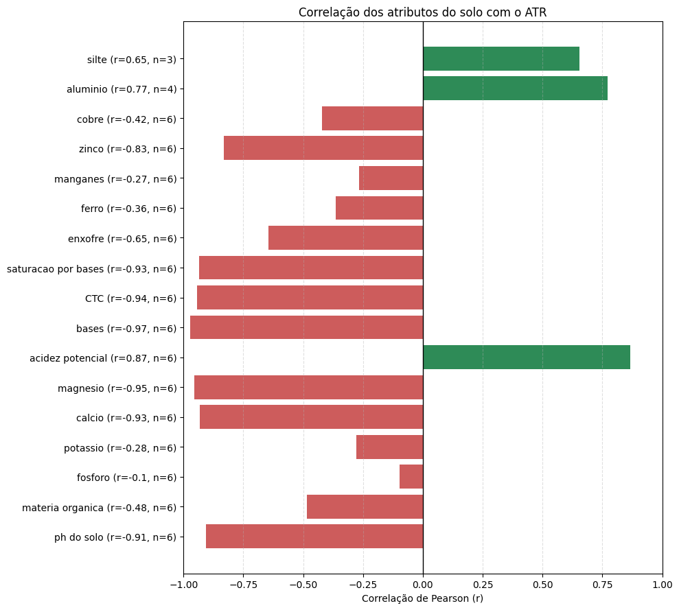

PC (r = 0,998), Pol (r = 0,997) e Brix (r = 0,982) tiveram correlações elevadas. Esses indicadores estão ligados à qualidade tecnológica da cana e ao cálculo do ATR. Seu uso em um modelo pré-colheita dependeria de estarem disponíveis no momento da estimativa.

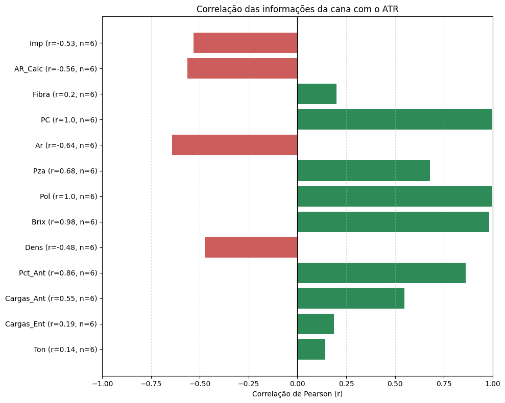

A matriz mostra as associações entre um subconjunto dos atributos do solo e o ATR. Cada par usa os anos disponíveis para as duas variáveis, por isso os coeficientes podem ter números diferentes de observações. As células cinzas, com `s/d`, indicam coeficientes indisponíveis.

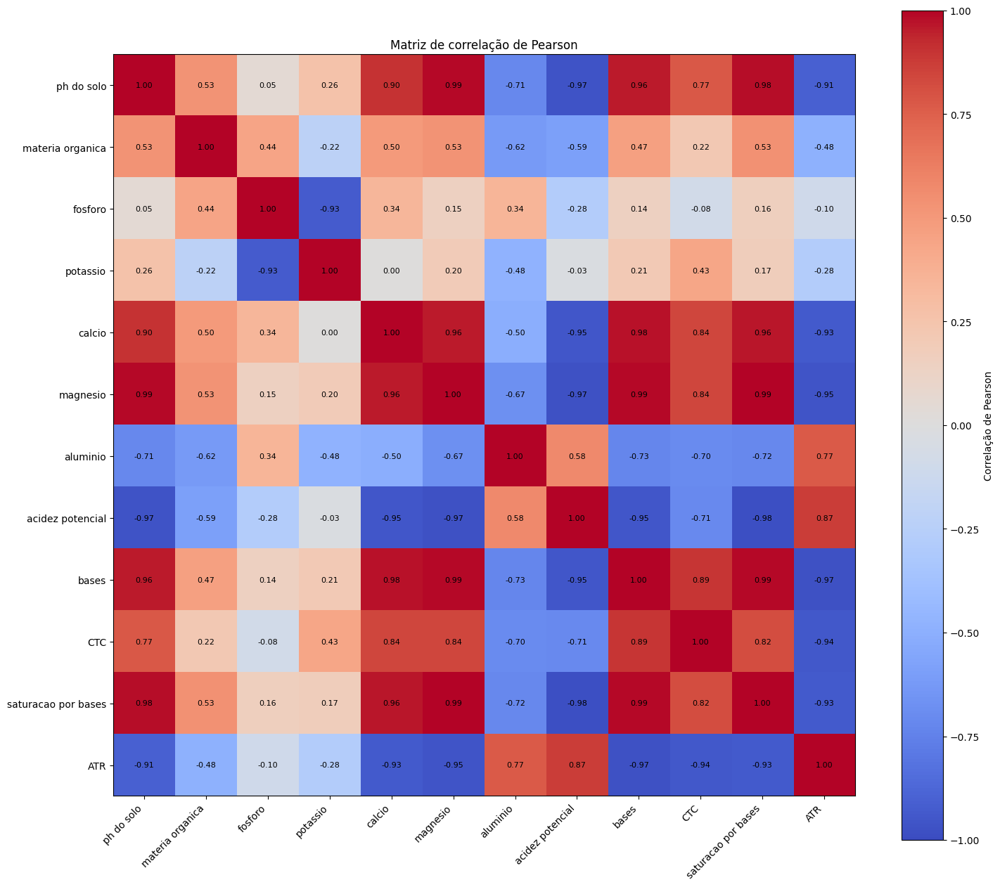

### Dispersões e regressões lineares

Cada ponto representa um ano civil. As dispersões permitem identificar quais anos sustentam as tendências e observar pontos que se afastam dos demais.

<details>
<summary>Ver os quatro gráficos de dispersão</summary>

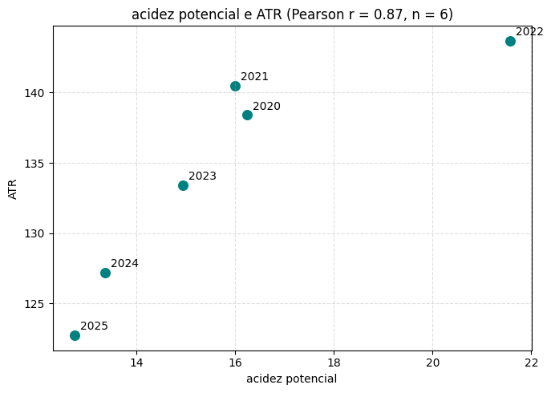
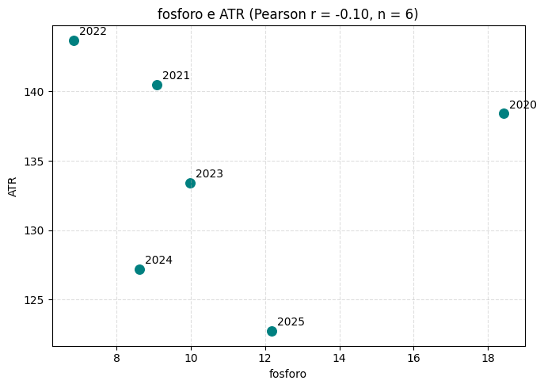
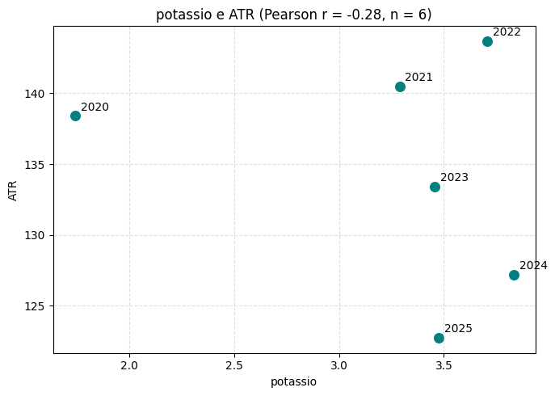
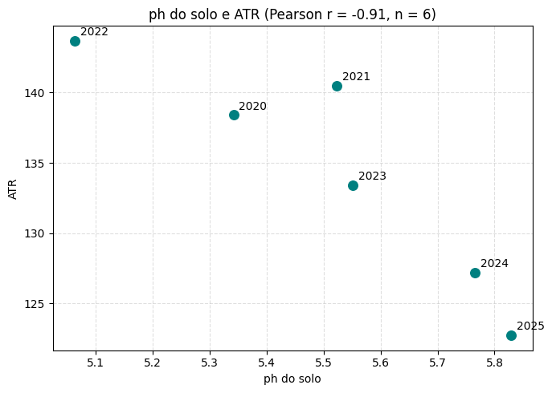

</details>

A execução salva gerou quatro regressões com seis observações cada. As inclinações foram −26,10 para pH, 2,24 para acidez potencial, −0,19 para fósforo e −2,95 para potássio, em kg/t de ATR por unidade do respectivo atributo. As escalas dos atributos diferem, portanto as inclinações não medem diretamente sua importância relativa. A argila tinha apenas dois anos válidos e ficou abaixo do mínimo de três para calcular a correlação e ajustar uma reta.

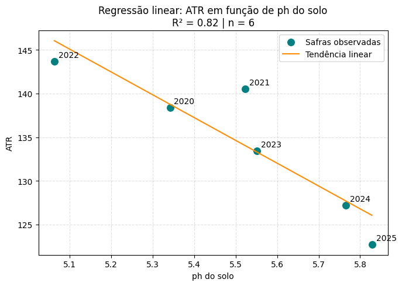

<details>
<summary>Ver os outros três gráficos de regressão</summary>

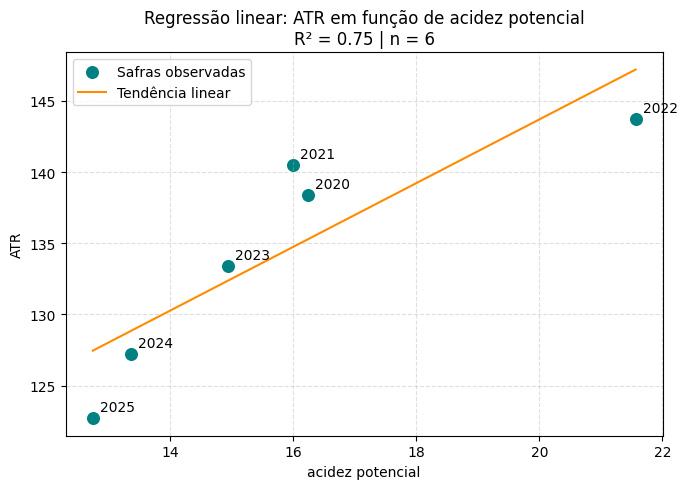
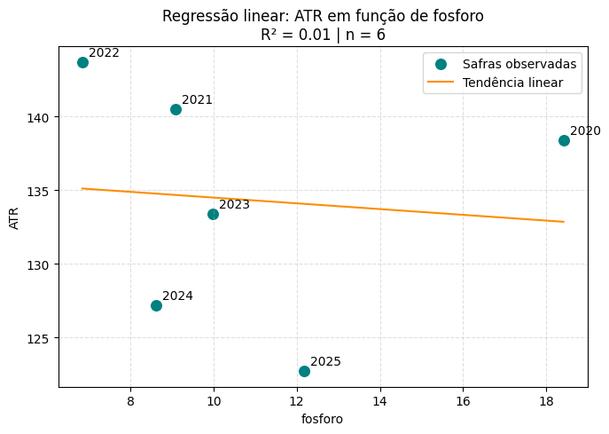
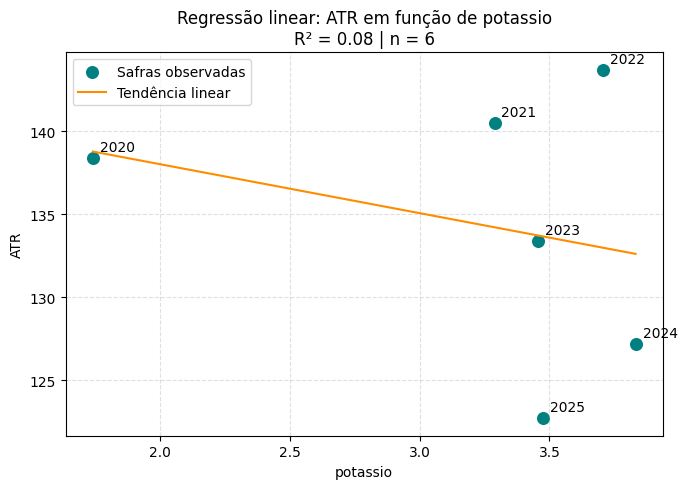

</details>

## Conclusões e limitações

Os resultados descrevem associações entre médias anuais e ajudam a formular hipóteses. O pareamento pelo ano civil não confirma a correspondência por propriedade ou talhão, nem garante que a amostragem de solo antecedeu o período avaliado da cana. Com seis observações e R² calculado na própria amostra, os ajustes ainda precisam de avaliação em dados independentes para sustentar uma previsão. A análise atual também não incorpora medidas de saúde da soqueira.

A composição das variedades pode ser descrita para os talhões amostrados. Para estimar ATR por variedade e corte, falta uma base de cana que identifique esses grupos e contenha as respectivas toneladas e medições de ATR. Na execução salva, a etapa final indicou a ausência de `Talhao`, `Variedade` e `Corte` na base de cana. Antes de interpretar os resultados agronomicamente, é necessário conferir a codificação dos zeros de alumínio, os registros de textura e as unidades dos laudos.

## Execução no Google Colab

Abra `notebooks/CYBEL.ipynb` no Colab e coloque os CSVs em `/content/ProjetoIntegrador_I/dados tratados` ou `/content/dados tratados`. A primeira célula lê os arquivos da pasta, detecta o separador e aceita UTF-8 com ou sem BOM. Execute as células em ordem. Após trocar os arquivos ou os critérios de tratamento, reexecute o notebook para atualizar as saídas.

## Execução no VS Code

Instale as extensões **Python** e **Jupyter**, abra a pasta do projeto e execute no terminal PowerShell:

```powershell
py -m venv .venv
.\.venv\Scripts\Activate.ps1
python -m pip install -r requirements.txt
```

Abra `notebooks/CYBEL.ipynb` e selecione o kernel `.venv`. A primeira célula lê os CSVs da pasta `dados tratados`. O notebook espera arquivos identificados como `DADOS_SOLO`, `Cana.csv` e, opcionalmente, `ART.csv`, com as colunas utilizadas nas células seguintes.

Use **Run All / Executar Tudo** para executar todas as células em ordem, ou **Shift+Enter** para avançar uma célula por vez. Os CSVs utilizados estão disponíveis na pasta `dados tratados` do repositório; os arquivos de `dados brutos` permanecem locais.

**Dependências do ambiente:** `requirements.txt` contém as bibliotecas diretamente utilizadas e o kernel necessário para executar o notebook no VS Code:

| Ferramenta | Uso no projeto                                                                            |
| ---------- | ----------------------------------------------------------------------------------------- |
| Pandas     | Leitura dos CSVs, preparação das tabelas, datas e conferências estatísticas.          |
| NumPy      | Ajuste das regressões lineares com `polyfit` e ordenação dos pontos com `argsort`. |
| Matplotlib | Gráficos de barras, matriz de correlação, dispersões e retas de regressão.           |
| ipykernel  | Execução do notebook no kernel Python do ambiente `.venv`.                            |

As versões registradas correspondem ao ambiente local do projeto. As dependências internas dessas bibliotecas são instaladas automaticamente pelo pip. `pathlib` faz parte da biblioteca padrão do Python.

**Organização do trabalho:** Git/GitHub para versionamento, Trello para tarefas e Overleaf para redação do artigo.

## Equipe

Beatriz dos Santos Lio; Bruno Bentivoglio Cezare; Camilla Nogueira Faria Piovani; Élio Rossi Neto; Leonardo Almeida Santos Brito; Yasmim Freitas de Camargo.

**Orientadora:** Profª Dra. Fernanda Pereira Guidotti Carneiro.

Código sob [licença MIT](LICENSE).
